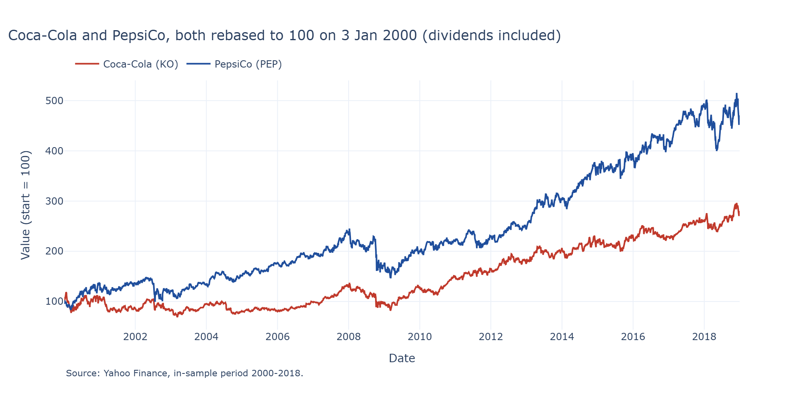
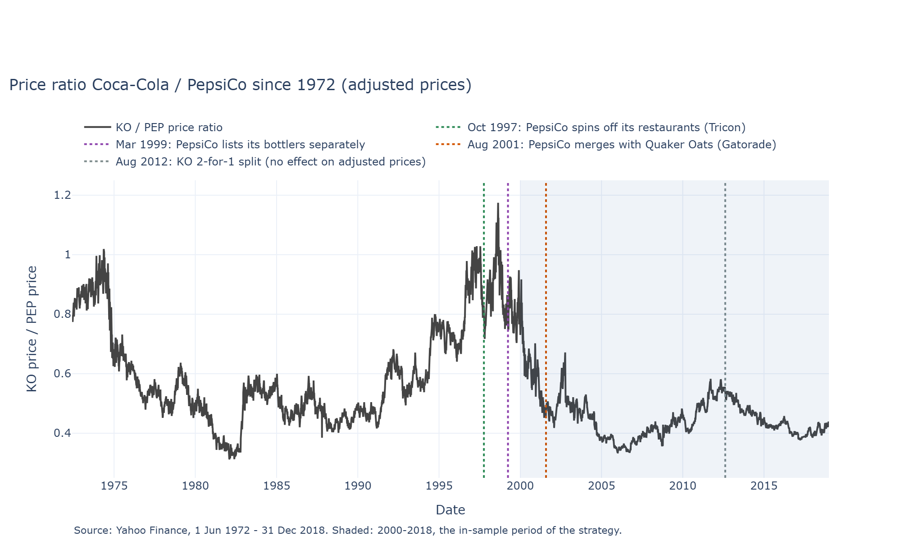
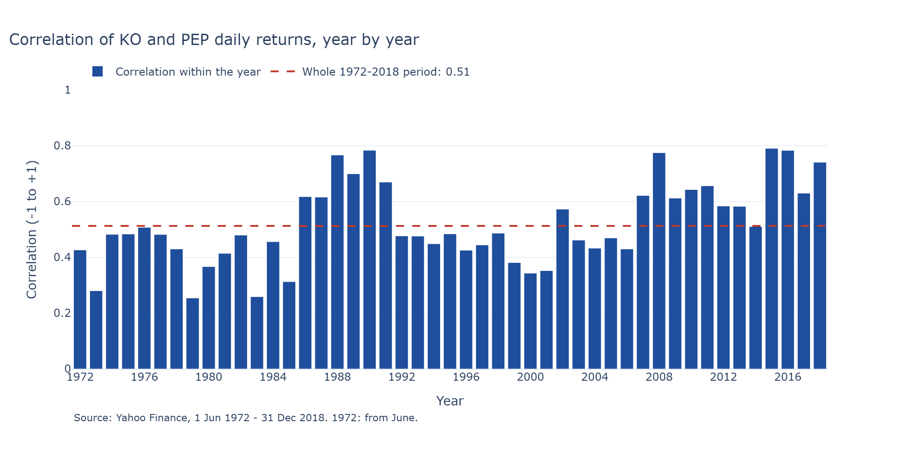
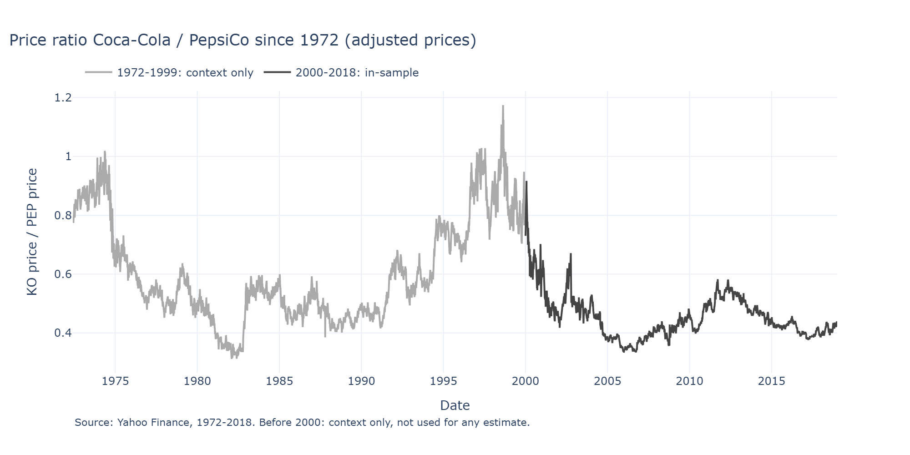

# Pairs trading: a mean-reversion signal and how hard I tried not to fool myself

BlackSwanQuants take-home project (returning contributors track), 10 October 2026.

## Summary (half a page)
_To be written at the end of the day: which phases I completed, which method I picked where there was a
choice and why, what I would do with more time._

## How to run
```bash
uv sync                      # exact versions from uv.lock, Python 3.12
uv run pytest                # unit tests + every notebook run top to bottom (~20 s)
```
Notebooks (one per phase) are in `notebooks/` and run on the `.venv` kernel.
No API key is needed. `.env` is optional (see `.env.example`).

## Repository layout
| Path | Content |
|---|---|
| `src/pairs/` | Library code (typed, documented, logged) |
| `notebooks/` | One notebook per phase, each ending with assertions on its numbers |
| `tests/` | pytest unit tests |
| `results/` | Figures and the SQLite log of every backtest I ran |

## Phases

### Phase 1: Data — do Coca-Cola and PepsiCo move together?
Notebook: [`notebooks/01_data.ipynb`](notebooks/01_data.ipynb). Pair: **Coca-Cola (KO) / PepsiCo (PEP)**.

**Set-up, fixed before downloading any price** (commit `feat: fix pair and in-sample split before looking
at data`): in-sample 2000-01-03 to 2018-12-31 (19 years, used for every look and every estimate),
out-of-sample 2019-01-01 to 2026-10-09 (~29% of the data, run once at the end). Phase 1 looks at the
in-sample period only (the brief requires the split for testing; applying it to this descriptive phase
is my own, more cautious choice). Daily **adjusted close** from Yahoo Finance (dividends and splits
included), so that a dividend payment does not look like a price drop.

**Why 2000, although Yahoo has both stocks from 1972.** (1) PepsiCo only became comparable to Coca-Cola
at the end of the 1990s: it spun off its restaurants (Pizza Hut, KFC, Taco Bell) on 6 Oct 1997 and listed
its bottlers separately on 31 Mar 1999 (SEC filings, linked in the notebook); the Quaker Oats merger of
2 Aug 2001 stays inside the sample. (2) US stocks were quoted in fractions of a dollar until 29 Jan 2001
(NYSE), so trading costs are not comparable. (3) The Phase 2 spread comes from a regression on price
levels, and from 1972 to 2018 adjusted prices grow 131x (KO) and 236x (PEP): one regression would be
dominated by recent years. The start was fixed before downloading any price and is not moved after
seeing the data.

**Data checks.** 4,779 trading days, no missing values, no duplicate dates, nothing removed; the
longest pauses are real exchange closures (11 September 2001, Hurricane Sandy) and the largest one-day
moves are real events (traded on 2.8-7.5 times the normal volume, not reversed). Every corporate action is
reported in the notebook: one **stock split** (KO, 2-for-1, 13 Aug 2012, already applied backwards by
Yahoo; checked: no fake -50% day) and 152 quarterly **dividends**. Rebuilding Yahoo's adjustment from
the dividend list matches it to 0.003%, but listing the dividends one by one revealed **an error in
Yahoo's data**: a KO dividend on 10 Sep 2001 that was never paid (a duplicate at its pre-split amount),
which adds a fake +0.73% gain to KO that day. It is corrected in the validated data (`KNOWN_DIVIDEND_ERRORS`
in `src/pairs/data.py`); the raw download is kept as received.

| Both prices, rebased to 100 | Price ratio KO / PEP |
|---|---|
|  |  |



**What I learn.** The two stocks are linked, and increasingly so: the correlation of daily returns is
0.55 over 2000-2018, never below 0.3 in any year, rising from about 0.35 (2000-01) to 0.6-0.8 after
2007. But the relationship is **not stable over the whole period**: in 2000 KO was the more expensive
share (about $56 vs $37) and between 2000 and 2004 it steadily lost that premium (the ratio falls from
0.73-0.9 to about 0.45, a drift); after 2004 the ratio oscillates between 0.34 and 0.58 and keeps
crossing its average, which is what pairs trading needs. Consequence: a hedge ratio estimated once on
2000-2018 is pulled by the early drift, so in Phase 2 the spread is checked, not assumed. Unsure: I did
not investigate *why* KO lost ground in 2000-2004.

**Before 2000, as context with less weight** (never used for any estimate). From 1972 to 1999 the daily
correlation is similar (0.50), but the price ratio moves in **long waves of about a decade** (about 1.0
in 1974, 0.31 in 1982, 1.17 in 1998): the relative level of these two stocks can drift for years before
coming back. Same data checks as above; 9 stock splits, all applied by Yahoo; the 1997 restaurant
spin-off is recorded by Yahoo as a $3.20 "dividend" per PEP share (plausible: one tenth of a Tricon
share at about $31).



_Phases 2-5: to be written as each phase is completed._

## Everything I tried
_Number of variants tested and how the shown one was chosen (from `results/trials.sqlite`)._

## Engineering standards
_Which of the programming guidelines I followed and where; which I skipped and why._

## AI usage disclosure
_What I asked the assistant to do, what I checked myself, where I overrode or corrected it._
