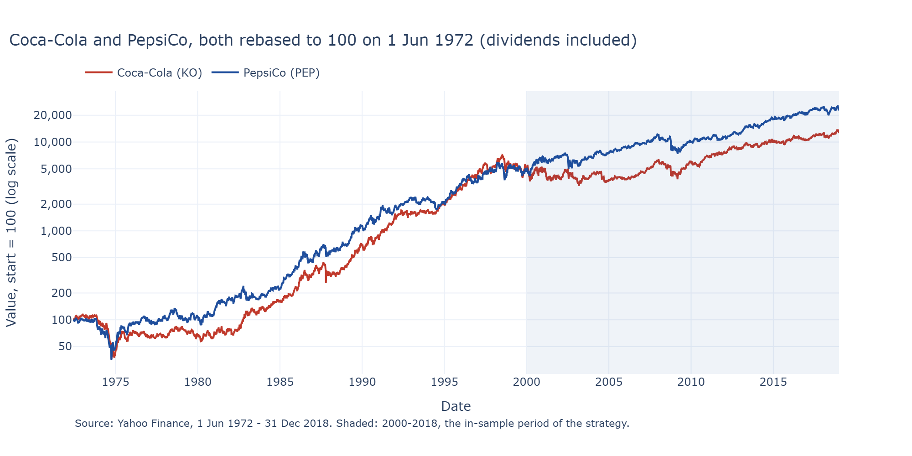

# Pairs trading: a mean-reversion signal and how hard I tried not to fool myself

BlackSwanQuants take-home project (returning contributors track), 10 October 2026.

## Summary (half a page)
_To be written at the end of the day: which phases I completed, which method I picked where there was a
choice and why, what I would do with more time._

## How to run
```bash
uv sync                      # exact versions from uv.lock, Python 3.12
uv run pytest                # unit tests + every notebook run top to bottom (~20 s)
```
Notebooks (one per phase) are in `notebooks/` and run on the `.venv` kernel.
No API key is needed. `.env` is optional (see `.env.example`).

## Repository layout
| Path | Content |
|---|---|
| `src/pairs/` | Library code (typed, documented, logged) |
| `notebooks/` | One notebook per phase, each ending with assertions on its numbers |
| `tests/` | pytest unit tests |
| `results/` | Figures and the SQLite log of every backtest I ran |

## Phases

### Phase 1: Data (warm-up) — Coca-Cola and PepsiCo over 46 years
Notebook: [`notebooks/01_data.ipynb`](notebooks/01_data.ipynb). Pair: **Coca-Cola (KO) / PepsiCo (PEP)**.

**Period.** The whole common history on Yahoo Finance, **1 Jun 1972 – 31 Dec 2018** (PepsiCo's first day
on Yahoo; `HISTORY_START` in `src/pairs/config.py`). The charts stop at 2018 because 2019–2026 is the
out-of-sample period, not looked at until the single final run; the same charts on 1972–2026 come after
it. Daily **adjusted close** (dividends and splits included), so that a dividend does not look like a
price drop.

**Data checks.** 11,749 trading days, nothing missing, nothing removed; the longest pauses are real
exchange closures (11 September 2001, President Ford's funeral, Hurricane Sandy) and the largest one-day
moves are real events (Black Monday 1987: KO -24.7%), with one possible data problem declared and left in
the pre-2000 history (PEP, 31 Aug – 1 Sep 1998). **Ten stock splits** (six KO, four PEP) are all correctly
applied by Yahoo: no fake -50% or -67% day, no volume jump. 187 quarterly cash dividends per company.
Rebuilding Yahoo's adjustment from its dividend list matches it to 0.003% over 46 years, but listing the
dividends one by one revealed **an error in Yahoo's data**: a KO dividend on 10 Sep 2001 that was never
paid (a duplicate at its pre-split amount), adding a fake +0.73% gain to KO that day. It is corrected
(`KNOWN_DIVIDEND_ERRORS` in `src/pairs/data.py`); the raw downloads are kept as received. PepsiCo's 1997
restaurant spin-off (Tricon) is recorded by Yahoo as a $3.20 "dividend": plausible, kept.

| Both prices, rebased to 100 (log scale) | Price ratio KO / PEP, with corporate events |
|---|---|
|  |  |


**What I learn.** The two stocks are **always linked day to day**: correlation of daily returns 0.51 over
46 years, between 0.25 (1979) and 0.79 (2015) in single years, strongest after 2007. But their **relative
level drifts over the decades**: the price ratio moves in long swings of 8 to 16 years, from 1.02 (1974)
to 0.31 (1982), up to 1.17 (1998, when KO's dividend yield hit its 46-year low of 0.8%) and down to 0.33
(2005). Only since about 2005 has it stayed in a narrow band (0.33–0.58), crossing back and forth, which
is what pairs trading needs. In 1972 and in 2000 KO was the more expensive share (about $132 vs $87, $56 vs
$37). Consequence: a spread can revert within months while the relationship drifts over years, so in
Phase 2 the spread is checked, not assumed, and Phase 3 tests the stability. Unsure: I did not investigate
*why* the ratio swings (KO's very high valuation in the late 1990s is a commonly cited reason, consistent
with its 0.8% yield, not proven).

**Why the strategy is estimated on 2000–2018 only.** (1) PepsiCo only became comparable to Coca-Cola at
the end of the 1990s: it spun off its restaurants on 6 Oct 1997 and listed its bottlers separately on
31 Mar 1999 (SEC filings, linked in the notebook); the Quaker Oats merger of 2 Aug 2001 stays inside the
sample. (2) US stocks were quoted in fractions of a dollar until 29 Jan 2001 (NYSE), so trading costs are
not comparable. (3) The Phase 2 spread comes from a regression on price levels, and from 1972 to 2018
adjusted prices grow 130x (KO) and 236x (PEP): one regression would be dominated by recent years.
The split (in-sample 2000-01-03 to 2018-12-31, out-of-sample to 2026-10-09) was **fixed in the code
before downloading any price** (commit `091e49f`, `feat: fix pair and in-sample split before looking at
data`) and is not moved after seeing the data. 19 in-sample years match what the brief asks for any pair
(at least 15–20).

_Phases 2-5: to be written as each phase is completed._

## Everything I tried
_Number of variants tested and how the shown one was chosen (from `results/trials.sqlite`)._

## Engineering standards
_Which of the programming guidelines I followed and where; which I skipped and why._

## AI usage disclosure
_What I asked the assistant to do, what I checked myself, where I overrode or corrected it._
