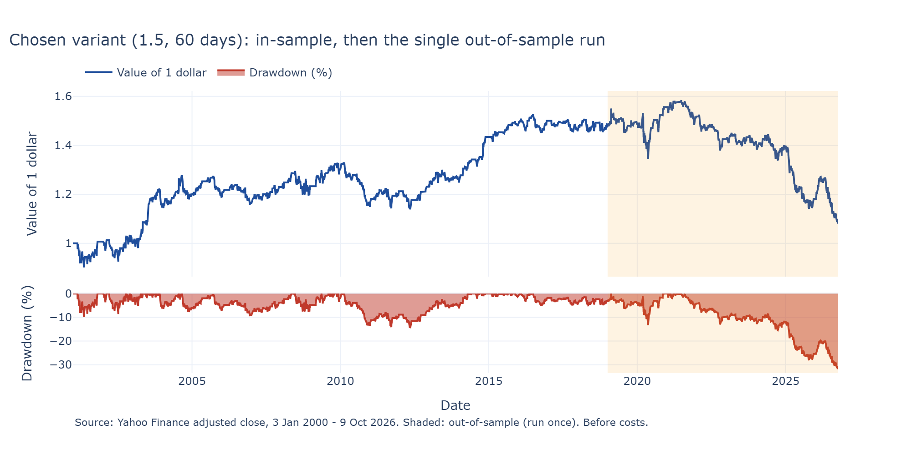
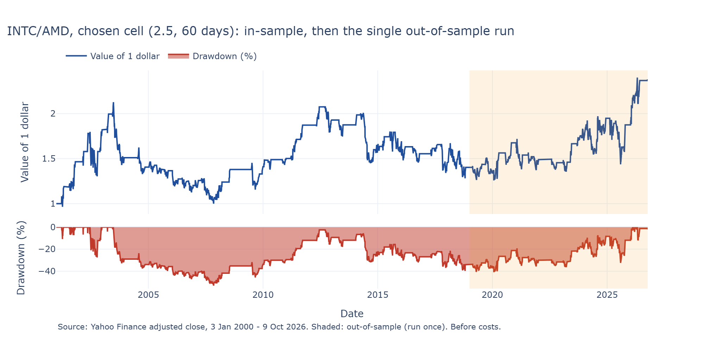

# Pairs trading on Coca-Cola and PepsiCo: a mean-reversion signal and how hard I tried not to fool myself

BlackSwanQuants take-home project (returning contributors track), 10 October 2026.

**Result in brief.** I trade the spread KO − 0.388 × PEP with a z-score signal. In-sample (2001–2018)
it earns a little but is not significant (Sharpe 0.35, t = 1.49). Run once on the out-of-sample years
(2019–2026) it loses (Sharpe −0.53). The simulations of Phase 5 say the spread does pull back over weeks to
months, but the profit the signal takes from it cannot be told apart from luck. Two optional extensions
confirm it: a hedge ratio that moves with a Kalman filter cuts the 2025 loss but earns less in-sample, and a
yearly walk-forward of the whole Phase 2 procedure, with trading costs, loses money in 2005–2026. On a
second pair, INTC/AMD, the same procedure finds an even weaker in-sample effect and a gain out-of-sample
(Sharpe 0.42, t = 1.17): with |t| below 2 on both pairs, I read both out-of-sample results as mostly luck.

## Writeup

**Phases completed: 1 to 5**, one notebook each in `notebooks/`, **plus three optional extensions**:
"Dynamic hedge ratio with a Kalman filter" (notebook 06), "Transaction costs and walk-forward"
(notebook 07) and "Second pair" (notebook 08, INTC/AMD, reduced scope). Where the brief offered a menu, I picked one method and wrote down why.

| Phase | What I did | Why this choice |
|---|---|---|
| 1. Data | 46 years of daily prices (1972–2018) for KO and PEP, the three charts of the brief, and a full check of the data | The adjusted prices depend on every split and dividend, so I checked all of them (below) |
| 2. Signal and validation | OLS hedge ratio on the in-sample prices, z-score on a rolling window, 25 variants chosen by a rule written in advance, one out-of-sample run | It is the brief's signal, written to the letter. I chose the "stable zone" instead of the best cell, because the best of 25 cells is the luckiest one |
| 3. Stability | Medium option: rolling hedge ratio and rolling ADF test on 2-year windows | A rolling correlation of daily returns cannot see my problem: the two stocks keep moving together day by day while the ratio of their prices slides for years |
| 4. Short interest | Nasdaq has PEP only and refuses KO, as the brief warns. I used FINRA, which has both stocks from December 2017 and matches Nasdaq exactly on PEP | The brief allows looking for another source. With FINRA I get both legs over almost nine years instead of one leg over twelve months |
| 5. Simulation | Joint block bootstrap of the in-sample days (1,000 paths, 10-day blocks), plus a declared extra check with an Ornstein-Uhlenbeck spread | The bootstrap needs no model. The Ornstein-Uhlenbeck option assumes the pull-back that Phase 2 could not prove, so I used it only as a second, declared check |
| Ext. Kalman filter | Intercept and hedge ratio as a random walk, updated every day with data up to the day before (δ = 1e-4, fixed in advance), same z-score and thresholds as Phase 2 | It is the direct answer to the Phase 2 failure: a hedge ratio fixed once on 2000–2018 cannot follow a relationship that changes |
| Ext. Costs and walk-forward | 2, 5 and 10 bp per leg on the frozen strategy; every year from 2005, β and the grid cell re-chosen on the 5 previous years with 5 bp costs, then one year of trading | Costs say if the small edge survives trading; the walk-forward says if the Phase 2 procedure works when it only knows the past |
| Ext. Second pair | INTC/AMD with the Phase 2 procedure unchanged (same split, grid, rule, one out-of-sample run) and the 500-day rolling β of Phase 3. No Phase 1 checks beyond gaps and moves above 25%, no short interest, no simulation, no costs | It tests if the KO/PEP result is specific to one pair. I cut the other phases for lack of time |

**Phase 1 and the data cleaning.** Before using the prices I went through every corporate event. Yahoo
handles all ten stock splits correctly. I listed the 187 quarterly dividends of each company one by one, and
this is how I found an error in Yahoo's data: a KO dividend on 10 September 2001 that was never paid (a
duplicate of the real one, at its pre-split amount). It creates a fake gain in the adjusted prices, and a
consistency check could not see it, because the error is inside the adjusted prices too. I corrected it in
the code and kept the raw download untouched. I also checked the extreme days and the gaps in the data:
nothing had to be removed. The strategy is estimated on 2000–2018 only. Before 1997–99 PepsiCo also owned
restaurants and bottlers, and before 2001 prices were quoted in fractions of a dollar.

**How I validated, and how many things I tried.** The in-sample / out-of-sample split was fixed in a commit
before I downloaded any price (`feat: fix pair and in-sample split before looking at data`). The grid and the
selection rule were committed before the first backtest (`feat: pre-register phase 2 signal grid and
selection rule`). The chosen strategy was frozen in a commit before the out-of-sample run, and that run
happened once (`feat: freeze the phase 2 strategy before the out-of-sample run`, then `chore: log the single
phase 2 out-of-sample run`). Nothing in Phases 3–5 changes the frozen strategy, and what they say about
2019–2026 is analysis after that single run. Every backtest and every test is logged in
`results/trials.sqlite`: **122 in total**, 114 fixed in advance and 8 exploratory (decided after seeing
results, and labelled like that in the notebooks). The rules of each extension were also committed before
computing (`feat: pre-register the rules of the Kalman hedge ratio extension before computing`, `feat:
pre-register the transaction cost and walk-forward rules before computing`, `feat: pre-register the second
pair INTC/AMD`, committed before downloading its prices), but all three extensions come after
the single out-of-sample run, so for them 2019–2026 is not a fresh test. Two extra checks only re-measure runs already logged (a
robust t-statistic in Phase 2, a drawdown check in Phase 5), so they are not counted; the notebooks say
when I added them.

| Phase | Trials logged | Of which exploratory |
|---|---|---|
| 2. Grid (25), small changes around the choice (24), out-of-sample run (1) | 50 | 0 |
| 3. Two labels × three windows × in/out-of-sample | 12 | 0 |
| 4. Comparisons with short interest | 11 | 5 |
| 5. Simulation configurations and the variance-ratio test | 8 | 3 |
| Ext. Kalman filter: main δ and two sensitivity values × in/out-of-sample | 6 | 0 |
| Ext. Costs: three levels × in/out-of-sample | 6 | 0 |
| Ext. Walk-forward: 5-year training and two sensitivity windows (550 + 475 + 475 grid backtests inside) | 3 | 0 |
| Ext. Second pair INTC/AMD: grid (25), out-of-sample run (1) | 26 | 0 |

The last cell of each notebook checks the numbers of its text with `assert`s, and the test suite runs all
notebooks from top to bottom.

## Conclusion

| Frozen strategy (entry 1.5, window 60 days, exit 0, β 0.388) | In-sample 2001–2018 | Out-of-sample 2019–2026 |
|---|---|---|
| Sharpe ratio | 0.35 | −0.53 |
| t-statistic (Newey-West, 10 to 120 lags) | 1.49 (1.69 to 1.78) | −1.49 (−1.64 to −1.47) |
| Return per year | +2.4% | −3.8% |
| Worst drawdown | −14% | −32% |
| Trades | 94 | 36 |



I found a small effect and no strategy that survives. In-sample all 25 variants earn something, but none
reaches t = 2, and the best parameters move from one decade to the next. Out-of-sample the strategy loses,
because from 2024 Coca-Cola pulls away from PepsiCo and the strategy keeps betting on a return that does
not come (Phase 2). The hedge ratio is far from stable even in-sample: on 2-year windows it goes from −0.07
to 0.75, and in 2025 it falls to −0.23 (Phase 3). Short interest does not line up with any of this (Phase 4). On
1,000 reshuffled histories the signal is positive 74% of the time, but its typical Sharpe ratio is 0.17,
half of what I found in-sample, and my real drawdown of −14% was unusually mild (median −32%). The spread
does pull back over weeks to months in 2000–2018, much more than chance would give (Phase 5; a test I added
after seeing the first results, so exploratory). So there is a real pull-back over weeks to months, but
not to a fixed level, and the strategy built on it is a small edge that 2000–2018 showed at its best, and
nothing in the in-sample data could have warned about the break after 2024.

The two extensions point the same way. A Kalman hedge ratio follows the change after 2023 and loses only
1.3% in 2025 (the frozen strategy lost 16.4%), but it earns less in-sample (Sharpe 0.15 against 0.42 on
the same days, all of it from the 2008 crisis) and still loses out-of-sample (−0.18). Trading costs are a
small part of the story: at 5 bp per leg the in-sample Sharpe goes from 0.35 to 0.28, because the strategy
trades only 94 times in 18 years. The walk-forward matters more. When the Phase 2 procedure re-chooses β and
the cell every year using only the past five years, it loses in 2005–2018 as well (Sharpe −0.16) and
−0.23 over 2005–2026. So the good in-sample result of Phase 2 needed the whole 2000–2018 period in view to
choose β and the cell.

| Sharpe ratio | Up to 2018 (walk-forward from 2005) | 2019–2026 |
|---|---|---|
| Frozen strategy with 5 bp costs | 0.28 | −0.60 |
| Kalman hedge ratio, no costs | 0.15 | −0.18 |
| Walk-forward, 5-year training, 5 bp costs | −0.16 | −0.35 |

The second pair, INTC/AMD, was done with less time and after seeing all of the above. With the same
procedure the in-sample grid is weaker than for KO/PEP (Sharpe from −0.18 to 0.19, and only one positive
zone score). The rule picks threshold 2.5 and window 60: in-sample Sharpe 0.19 (t = 0.82), worst drawdown
−53%. The single out-of-sample run gains: Sharpe 0.42, t = 1.17, 9.1% a year. I had predicted a loss, so
I was wrong. But the 500-day rolling β of INTC on AMD goes from −1.36 to 0.90, so there is no stable
relation behind the gain. On two pairs, the same procedure gives a small, not significant effect
in-sample, and out-of-sample one loss and one gain, both with |t| below 2. That is what noise looks like.



What I am not sure about: 7.8 out-of-sample years are few, and even a true Sharpe ratio of 0.5 could look
like zero there. The numbers of Phases 2–5 and of the Kalman extension are before trading costs (the
Kalman version trades twice as often, so costs would hurt it more). And the second pair has a reduced analysis, without costs and without the data checks of Phase 1.

## What I would do with more time

1. **Use the whole history with a wider out-of-sample.** First a single 70/30 split of 1972–2026
   (in-sample to about mid-2010, out-of-sample after), with the same rules frozen in advance. Two cautions.
   It is no longer a clean test, because I have already seen 2000–2026. And before 2000 PepsiCo was a
   different company. I would also estimate the hedge ratio on log prices, so that the growth of the prices
   (about 130 times for KO from 1972 to 2018) does not let the recent years dominate the regression. Then I
   would run the walk-forward of notebook 07 over the whole period, not only from 2005.
2. **Costs on every backtest**, including the Kalman version and INTC/AMD, and the cost of borrowing the
   short leg.
3. **The full set of phases on INTC/AMD**: the date-by-date check of splits and dividends, short interest
   (Nasdaq has both legs) and the simulation.

## AI Usage Disclosure & Workflow Architecture

In alignment with the project brief's encouragement to use AI assistants, I integrated Claude Code as my primary execution engine. My approach was to act as the quantitative architect: I defined the strategy, the validation constraints, and the statistical methodologies, while the AI handled code generation, unit test scaffolding, and initial text drafting. This disclosure outlines our division of labor, detailing what I supervised, where I overrode the model, and the structural safeguards I implemented.

**Division of Labor & Structural Safeguards**
* **Strategic Direction:** I independently selected the KO/PEP pair, defined the in-sample/out-of-sample temporal split, and chose the specific analytical methods for each phase.
* **Commit Protocol:** I strictly enforced a "no autonomous pushes" rule. Every commit was reviewed locally before execution, ensuring the out-of-sample data remained completely untouched during the exploratory phases.
* **Pre-registration:** I required all selection rules (e.g., the stable-zone rule in Phase 2) to be committed *before* running any backtests to definitively prevent look-ahead bias and curve-fitting.

**Critical Overrides and Corrections**
During the execution, I actively supervised the output and intervened on several critical analytical steps:
* **Data Integrity:** I mandated a manual check of every stock split and dividend. This led to my discovery of a duplicated KO dividend in Yahoo Finance's raw data (September 2001) that the AI failed to catch. I manually corrected this in the code to prevent a fake gain in the adjusted prices.
* **Constraint Navigation:** In Phase 4, the AI suggested skipping the KO short interest analysis entirely because Nasdaq lacks the data. Following the brief's allowance to seek alternative sources, I overrode the AI and sourced complete FINRA data for both legs.
* **Analytical Rigor (Phase 5):** The AI generated an initial conclusion for the simulation phase that contradicted the data by hyper-focusing only on the Sharpe ratio. I demanded a full metric table and a harsh critical review, which revealed that the actual empirical drawdown was significantly milder than the simulated paths—a structural nuance the AI had completely missed.
* **Statistical Validity:** The AI incorrectly claimed the t-statistic was overly optimistic. I forced a Newey-West computation (10 to 120 lags) to properly account for autocorrelation, mathematically proving the AI's assumption wrong.

**Model Hallucinations and Automated Checks**
* **Phantom Metrics:** The AI hallucinated specific numerical values from memory (e.g., an incorrect ratio in Phase 5, citing "9 years" instead of 8 in Phase 2, and fabricating a sentence about 2025 losses without computing them). I caught these via automated `assert` statements that I intentionally designed and placed at the end of each notebook.
* **Drafting Style:** The AI's initial markdown prose was overly polished and lacked quantitative precision. I imposed a strict, plainer rewriting style to ensure the text accurately reflected the empirical findings without rhetorical fluff, locking down the pre-registered numbers through automated checks across all notebooks.

*(The full diary of my corrections and of the AI's mistakes, in Italian, is preserved exactly as it was generated in `ai/correzioni.md`, maintaining total transparency).*

To keep the delivery tidy, I removed from the final commit the AI's working log and its hand-over notes between chat sessions (`ai/STATO.md`, `ai/ripartenza.md`, `ai/prompt_*.md`, `ai/piano_fase2.md`). Nothing was edited: they are in the git history.
## How to run

```bash
uv sync          # Python 3.12, exact versions from uv.lock
uv run pytest    # unit tests, then every notebook from top to bottom (about 3 minutes)
```

The notebooks are in `notebooks/`, one per phase plus 06 and 07 for the extensions, and run on the `.venv`
kernel. On Windows set
`PYTHONUTF8=1` before running them from the command line. No API key is needed. All downloads are saved as
pickle checkpoints in `data/` (Yahoo rewrites its adjusted prices, so a new download would not reproduce
the results). The Phase 5 simulation takes about four minutes, so it is saved in
`data/phase5_simulation.pkl`; deleting that file recomputes it with the same seed.

| Path | Content |
|---|---|
| `src/pairs/` | Library code: data, spread, backtest, stability, short interest, simulation, Kalman filter, costs and walk-forward, trial log |
| `notebooks/` | One notebook per phase and per extension, each ending with assertions on its numbers |
| `tests/` | pytest unit tests, and a test that runs every notebook |
| `results/` | Figures and the SQLite log of every trial (`trials.sqlite`) |
| `ai/` | Files produced by the AI assistant, left as they are (see the disclosure) |

The code follows the programming guidelines (typed, NumPy docstrings, ruff and mypy in pre-commit and CI,
custom exceptions, `as_of` dates in every estimate). I skipped the optional PySide6 viewer.

## Glossary

| Term | Meaning |
|---|---|
| ADF test (Augmented Dickey-Fuller) | A test of whether a series is stationary; a low p-value says it keeps returning to a fixed average, and Phase 3 runs it on rolling windows of the spread. |
| Adjusted close | The closing price rewritten by Yahoo for later splits and dividends, so that its changes measure the total return of holding the share; all returns in this project use it. |
| Autocorrelation | The correlation of a series with its own earlier values; if daily returns are autocorrelated, a plain t-statistic can overstate the evidence. |
| Basis point (bp) | One hundredth of a percent (0.01%); notebook 07 charges 2, 5 or 10 bp of the value traded on each leg. |
| Backtest | A replay of a trading rule on past prices, day by day, to see what it would have earned using only information available at the time. |
| Block bootstrap | Building synthetic histories by gluing together randomly drawn blocks of consecutive real days; in Phase 5 each block holds both stocks on the same days. |
| Close | The last traded price of the day as it was quoted at the time, before any later adjustment for splits or dividends. |
| Correlation of daily returns | A measure of how much the daily percentage moves of two stocks go up and down together; Phase 1 uses it to see how closely KO and PEP are linked. |
| Days to cover | Short interest divided by the average daily volume, that is the number of normal trading days short sellers would need to buy back their shares. |
| Dividend | Cash a company pays to its shareholders, quarterly for both KO and PEP. |
| Dividend yield | The cash dividends paid in a year divided by the average share price of that year; a low yield means the share is expensive compared with the cash it pays. |
| Drawdown | The loss from the highest value reached so far to a later low; the worst drawdown is the deepest such fall over the whole period. |
| Engle-Granger test | A stationarity test for a spread built with an estimated hedge ratio; it is stricter than a plain ADF test because the ratio was fitted to make the spread look stable. |
| Entry threshold | The size of the z-score at which the strategy opens a position; it is one of the two parameters tuned in Phase 2, together with the window. |
| Ex-date | The first day a buyer of the share no longer receives the next dividend, so the price drops by about the dividend on that day. |
| Exploratory check | A test decided after seeing some results; it is reported and logged in the trial log, but it carries less weight than a pre-registered one. |
| FINRA | The US regulator of brokers, which collects and publishes short interest for every listed stock; Phase 4 uses it because Nasdaq's free data covers only PepsiCo. |
| Half-life | The number of days a deviation of the spread from its average takes to shrink by half, estimated by regressing the daily change of the spread on its previous level. |
| Hedge ratio (β) | The number of PEP shares held against one KO share, estimated by OLS of the KO price on the PEP price, so that the spread moves as little as possible. |
| In-sample | The earlier part of the data, the only part used to estimate and tune the strategy. |
| Kalman filter | A method that updates an estimate every day as new data arrives, giving more weight to the new data when the old estimate is uncertain; notebook 06 uses it to let the hedge ratio change over time. |
| Leg | One of the two stocks in a pairs position, for example the long KO leg and the short PEP leg. |
| Log scale | A chart axis on which equal distances mean equal percentage changes, so that growth over many decades stays readable. |
| Long the spread | Buying KO and selling β shares of PEP, a bet that the spread will rise; the strategy does this when the z-score is very negative. |
| Look-ahead bias | Using information in a decision that was not yet known at that moment; here the position decided at the close of one day only earns the next day's move. |
| Mean reversion | The tendency of a series to move back toward its average after moving away from it, which is what pairs trading bets on. |
| Median | The middle value of a list once it is sorted, so half of the values are below it; Phase 5 uses it to describe the typical simulated path. |
| Newey-West standard errors | Standard errors that allow returns on nearby days to be correlated; Phase 2 uses them to recheck the t-statistic of the strategy. |
| OLS (ordinary least squares) | The usual linear regression, which picks the line that makes the sum of squared errors as small as possible; it gives the hedge ratio. |
| Ornstein-Uhlenbeck process | A random walk with a spring: every day the value is pulled back toward a long-run average by a fixed fraction of its distance, plus a random shock. |
| Out-of-sample | The later part of the data, kept untouched while building the strategy and then used for a single run of the frozen strategy. |
| P&L | Profit and loss, the money a position gains or loses. |
| p-value | The probability of a result at least as extreme as the one observed if there were really no effect; a small p-value is evidence against "no effect". |
| Pairs trading | A strategy that trades two related stocks against each other, betting that when their prices move apart they will come back together. |
| Percentile | The value below which a given share of a list falls; saying the real result is at a high percentile means it beats most simulated paths. |
| Post-hoc | Decided after seeing the data or the results; post-hoc rules can fit noise, so they are marked as such and logged. |
| Pre-registration | Writing down and committing the rules, the choice procedure and the expected outcome before running the test, so the results cannot shape them. |
| R² | The share of the variation in one variable that a regression explains; for two prices that both grow over time it can be high without a real link. |
| Random walk | A series whose next move is unpredictable and has no pull back to any level, a common model for stock prices. |
| Rank (Spearman) correlation | A correlation computed on the ranks of the values instead of the values themselves, so a single extreme point cannot drive it; Phase 4 uses it. |
| Regime | A period in which the relationship between the two stocks behaves in one way, for example before and after KO started pulling away from PEP. |
| Relative shorting | The change in log short interest of KO minus that of PEP over a half-month; Phase 4 compares it with the moves of the spread. |
| Rolling window | A fixed number of the most recent days used for a calculation that is repeated every day, such as the rolling mean of the z-score or the rolling hedge ratio. |
| Sensitivity check | Rerunning an analysis with small changes to its parameters; if a tiny change collapses the result, the result was probably noise. |
| Settlement date | The date on which short positions are counted for the short interest report, twice a month; the data are published some trading days later. |
| Sharpe ratio | The average yearly return divided by the yearly volatility of returns, a measure of return per unit of risk. |
| Short interest | The number of shares of a stock currently sold short and not yet bought back. |
| Short selling | Borrowing shares and selling them, a bet that the price will fall; the short seller must also pay any dividends to the lender. |
| Short the spread | Selling KO and buying β shares of PEP, a bet that the spread will fall; the strategy does this when the z-score is very positive. |
| Spin-off | A company separating one of its businesses into a new listed company and giving the new shares to its shareholders, as PepsiCo did with its restaurants before the in-sample period. |
| Spread | The price of KO minus β times the price of PEP, the quantity the strategy trades. |
| Stable-zone rule | The pre-registered selection rule of Phase 2, which picks the parameter cell whose neighbours also do well instead of the single best cell. |
| Standard error | The typical size of the error in an estimate due to chance; a result many standard errors away from zero is unlikely to be luck. |
| Stationarity | The property of a series that keeps returning to a fixed average with a stable spread around it, which a profitable spread trade relies on. |
| Stock split | A company dividing each share into several cheaper ones, which leaves the value of the holding unchanged; Yahoo rewrites earlier prices so no fake drop appears. |
| Synthetic path | An artificial price history built in Phase 5 from pieces of the real in-sample data, used to see how results vary across histories that could have happened. |
| t-statistic | An estimate divided by its standard error; here the Sharpe ratio times the square root of the years, and values near zero mean the result could be luck. |
| Total return | The gain from holding a share including both the price change and the dividends received. |
| Trading costs | Commissions, bid-ask spreads and borrowing fees paid when trading; results are before costs except in notebook 07, which charges a share of the value traded on each leg. |
| Trial log | The database in results/trials.sqlite that records every backtest and comparison run, so the number of attempts behind each result is visible. |
| Variance ratio | The variance of the spread's moves over several days compared with what its daily variance predicts for a random walk; a lower value means moves get partly undone later. |
| Volatility | The standard deviation of returns, a measure of how much they swing, usually expressed per year. |
| Volume | The number of shares traded in a day. |
| Walk-forward | Re-estimating a strategy on a past window and testing it on the following unseen period, then moving both forward and repeating; notebook 07 does it one year at a time. |
| Weak period | A day flagged in Phase 3 because the rolling ADF test on the spread gives a high p-value, meaning the recent spread looks less mean-reverting. |
| Welch t-test | A test of whether two groups have different averages that does not assume they have the same variance; Phases 3 and 4 use it to compare groups. |
| z-score | How many standard deviations the spread is from its rolling average over the last days, computed with past and current data only; it drives the trading signal. |
